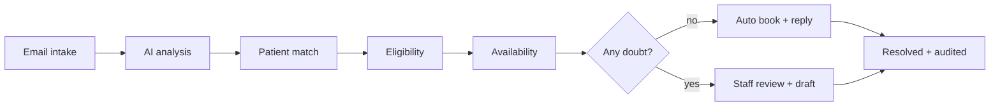

# DOCS Health Platform – Demo Guide

Nov 11, 2026

## 1. What it is

Docs Health turns scheduling emails into portal requests, matches each one to a patient chart, checks insurance, and then either books and replies automatically or hands the case to staff with the reason and a drafted reply. Every step is written to an audit trail.

**Who uses it:** scheduling staff (role *scheduler*) and administrators (role *admin*).

**The problem it solves:** staff no longer read each email, find the chart, check eligibility and look for open slots by hand. Routine requests (book, reschedule, cancel) finish on their own; anything doubtful goes to a person.

| Layer | Technology |
| --- | --- |
| Backend | Python 3.11+, FastAPI, SQLAlchemy 2 |
| Database | PostgreSQL (Alembic migrations, triggers, stored procedures) |
| AI model | Pluggable: Azure OpenAI, OpenAI, Gemini, Hugging Face, or an offline rule engine (`mock`, the default) |
| Frontend | React 19, Vite 6, Tailwind v4, served by an Express server that proxies `/api` |
| Email | Microsoft Graph (Outlook / M365), IMAP/SMTP, or a safe outbox that sends nothing |

## 2. Features

| Module | What staff get |
| --- | --- |
| Email intake | Reads scheduling mailboxes (Outlook via Microsoft Graph, IMAP, or a forwarded webhook). Duplicate emails are ignored by Message-ID. |
| AI analysis | Pulls intent (book, reschedule, cancel, question), patient details, insurance and preferred times out of the email, with a confidence score. |
| Patient matching | Scores candidate charts on date of birth, name, email, phone and member ID. A match is accepted only if it clears the threshold and leads the runner-up. |
| Eligibility and network | Sends a 270 request and stores the 271 response. Checks whether the provider is in network for the patient's payer. |
| Scheduling | Generates open slots from weekly templates, blocks double-booking, books, reschedules and cancels. |
| Auto reply | Sends a templated confirmation from database facts, in the same mail thread. |
| Manual review workspace | Shows the reason, the evidence and an editable draft reply, with actions: link patient, register, book, send, resolve, reopen. |
| Patient chart | EHR-style chart: face sheet, contact data, guarantor, insurance, appointments, release of PHI, amendments history, printable face sheet. |
| Eligibility tools | Detailed benefits view, raw 271 text, and discrepancies against the chart. A **Select** button copies a value onto the policy. An AI summary is shown only if every figure matches the 271. |
| Dashboard and logs | Request counts, review-trigger breakdown, email log and a full audit trail. |
| Demo lab | One click sends each of 11 sample emails through the real pipeline. |
| Administration | Microsoft 365 connection and mailboxes, SMTP setup, forgot-password flow, per-field encryption of SSN and driver's license. |

## 3. Workflow

Only the AI step reads free text. The rest is plain code. Every step is logged.

Status lifecycle: `received` → `processing` → `auto_responded` or `needs_review` → `in_review` → `resolved` or `closed`. A resolved request can be reopened and returns to `needs_review`.

1. **Intake.** An email arrives and becomes a portal request. Duplicates are ignored.
2. **AI analysis.** The model structures the email. If it fails, a rule engine takes over and the request goes to review.
3. **Patient match.** Deterministic scoring picks a chart, or flags the request as unmatched or ambiguous.
4. **Checks.** Insurance on file, conflicts with the chart, eligibility (270/271), network status, open slots.
5. **Decision.** No doubt: book, reschedule or cancel, then send a templated reply and resolve. Any doubt: stop before booking or sending, and hand over with a reason and a draft reply.

## 4. How each part works

**AI analysis.** The model returns a strict JSON structure: intent, patient details, insurance, provider and preferred times, plus a confidence score. It never decides identity, coverage or availability. If the model errors, rule-based extraction runs and the request is flagged `AI_ENGINE_ERROR`.

**Patient matching.** Weighted evidence from date of birth, name, email, phone and member ID. The best chart must score at least 0.80 and lead the runner-up by 0.2. Twins on one family account therefore become an *ambiguous match* instead of a guess. One exception: for a new-appointment request, a single chart with the exact first and last name and no conflicts is linked at a lower score of 0.60. The reply then says the visit was booked under that chart, so the patient can correct it.

**Eligibility and network.** A mock clearinghouse returns the 271 (member IDs starting `INV` return inactive, `ERR` returns a payer error). Network status comes from a provider-by-payer table. Dr. Patel is out of network with Humana, which shows that path.

**Scheduling.** Slots come from each provider's weekly template. Booking checks against double-booking. Reschedule cancels the old visit and books the new one. If the exact time asked for is taken, alternatives are offered.

**Replies.** Auto replies are fixed templates filled from database facts. An AI rewrite is used only if every date, time and name still appears word for word. Emergency symptoms produce a "call 911" draft for staff, never an automatic reply.

**Review workspace.** Staff see why the request stopped, the extracted data, the match evidence, eligibility, a stepper of the pipeline, and a draft reply they can edit. Actions: link or register the patient and re-run, book and confirm, send, resolve, reopen.

**Patient chart.** Banner with name, MRN, age, payer and eligibility. SSN and driver's license are masked. The eye icon reveals them and logs the view. Every field change appears under *Show Amendments History*.

**Settings and integrations.** Connect Microsoft 365 with sign-in (one-time state and PKCE), add mailboxes with per-mailbox options, check now or on a timer. Replies go out from the same mailbox in the same thread. A failed reply is marked and can be retried.

## 5. Validation and safeguards

The request stops for a person whenever any of these checks trips. Two defaults differ: if only the requested time is taken, the system replies with alternative slots instead of stopping, and a patient with no insurance on file is still booked, with a note to bring the card (setting `book_without_insurance`). Otherwise nothing is booked or sent until the check clears.

| Review reason | Trips when |
| --- | --- |
| Clinical red flag | Emergency wording such as chest pain or trouble breathing. Marked high priority. |
| Low confidence / AI error | Confidence below 0.80, or the model failed. |
| Unsupported intent | The email is not a scheduling action. |
| Incomplete data | A required detail is missing. |
| Unmatched / ambiguous patient | No chart matches, or several could. |
| Conflicting information | The email disagrees with the chart. |
| Insurance change / none on file | New card reported, or no active policy. |
| Eligibility failed | The 271 does not show active coverage. |
| Out of network | Provider not in network for the payer. |
| Provider, appointment or slot problem | Provider not on staff, no single appointment found, no openings, booking error, or the exact time is taken. |

**Security and data checks**

- Sign-in: 5 failed passwords lock an account for 15 minutes. 20 failures from one IP are refused. The error message is always the same, so accounts cannot be discovered. The IP count is kept in memory per server process.
- Password policy: 10+ characters with upper and lower case, a number and a symbol. Reset links are single use, expire in 30 minutes, and are stored as hashes only.
- Roles: admin and scheduler. Passwords hashed with PBKDF2-SHA256, API uses JWT bearer tokens.
- SSN and driver's license encrypted at rest. Revealing them is logged.
- The database role for the app can add audit rows but never update or delete them.
- Email: addresses and headers are checked for injection, TLS certificates are verified, retries happen only for temporary failures.
- Errors: database outage returns 503, conflict 409, bad input 422, anything else a 500 with a reference ID and no internal detail.

**Testing:** 167 backend test functions plus a script that runs all 11 PRD scenarios and prints expected against actual. `smoke_test` runs the same examples through the live API and reports which database rows each wrote.

**Go-live acceptance targets** (from the validation plan)

| Metric | Target |
| --- | --- |
| Intent accuracy | 95% or more on a shadow sample |
| Wrong-patient actions | Zero |
| Auto-reply factual accuracy | 100% |
| Unsafe requests routed to staff | 100% |
| Median first response | Under 15 min automatic, under 4 business hours for review |
| Staff adoption | 80% or more of scheduling email worked in the portal |
| Staff satisfaction | 4 out of 5 or better |

Rollout: a scripted demo, then 2 to 4 weeks in shadow mode with auto-send and auto-book off, then automation switched on in steps (cancellations first, then reschedules and existing-patient bookings).

## 6. Demo script

**Setup.** Run `.\run.ps1 deploy`, open the portal at http://localhost:5181 and sign in with the demo scheduler account from `backend\.env` (README default `scheduler@docshealth.local`). Keep `EMAIL_OUTBOUND_MODE=outbox` so nothing is emailed. Run `.\run.ps1 demo` beforehand to confirm every scenario matches.

**Suggested order:** Dashboard, then **Demo lab**: send scenario 1 and open the request to show the stepper, eligibility and reply. Then show two or three review cases, a patient chart, and finish on the Audit trail.

| # | Demo lab scenario | Expected result | Show staff |
| --- | --- | --- | --- |
| 1 | Existing patient books a physical | Auto-booked, reply stored, resolved | Stepper, eligibility, reply |
| 2 | Reschedule | Old visit cancelled, new one booked | Schedule and chart |
| 3 | Cancel | Cancelled, resolved | Chart history |
| 4 | New patient, no chart | Review: unmatched patient | **Register & re-run AI** then it books |
| 5 | Insurance eligibility fails | Review: eligibility failed | Edit the draft, resolve |
| 6 | Provider out of network | Review: out of network | **Book & confirm** with an in-network provider |
| 7 | Insurance conflicts with chart | Review: conflicting information | Fix the policy, **Re-run AI analysis** |
| 8 | Twins on one family account | Review: ambiguous match | Link the right chart |
| 9 | Emergency symptoms | Review: clinical red flag, high priority | Escalation, no auto reply |
| 10 | General question | Review: not a scheduling action | Use the draft |
| 11 | Incomplete request | Review: incomplete data | Ask for missing details |

**Chart demo:** Avery Morgan (payer says EPO, chart says PPO) and Jordan Ellis (payer date of birth differs) show the discrepancies view. Linda Brooks shows inactive coverage.

**What is real and what is simulated**

- Real: the pipeline, matching, scheduling, templates, audit trail, login protection, encryption, and the Microsoft Graph, IMAP and SMTP integrations once configured.
- Simulated by default: the AI engine (`mock` rule engine, no data leaves the server), the eligibility clearinghouse (deterministic mock, the real X12 vendor adapter is still to build), and sending (outbox stores replies without sending).
- All demo patients are fictional and use `example.com` addresses.

**Open items before production:** build the clearinghouse adapter (for example Availity or Waystar), sign a BAA with any hosted AI vendor, add Alembic migrations, and rotate the Hugging Face token that was committed in `backend/.env.example` before it was removed. Also known: a reschedule books the new slot before cancelling the old one, so a failed cancel can leave both booked; and a request carrying the ecosystem gateway secret signs in as the first active admin or scheduler, so audit entries for that path share one account.
